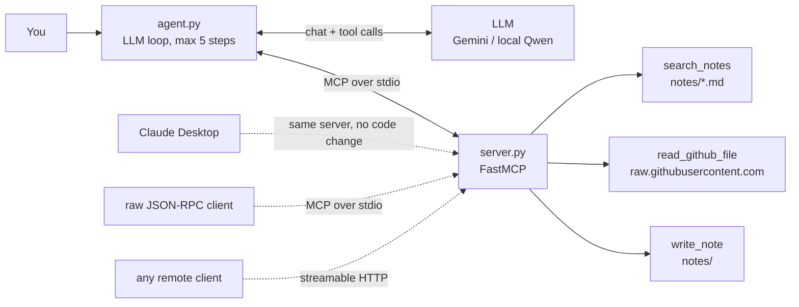

# MCP Agent

**An MCP server that gives an LLM agent three tools (search my notes, read a GitHub file, save a note), an agent that
uses them, and a measurement of how often it picks the right tool and answers correctly.** The same server runs
unchanged in any MCP client.


*(The GIF animates the real output of `python agent.py "..."` for the brief's two example questions, saved by
`scripts/record_demo.py`; it is not a screen recording. The demo ran Qwen2.5-3B on the GPU with the v2 search.)*

## How the parts connect



The agent knows nothing about notes or GitHub: it asks the server for its tools (`list_tools`), passes them to the
model as function definitions, and runs whatever the model calls. Swap the server and the agent gets new tools.

## Run it (three commands)

```bash
pip install -e .                              # Python 3.10+; MCP SDK pinned below 2 (v2 renames FastMCP)
copy .env.example .env                        # then paste your free GEMINI_API_KEY from Google AI Studio
python agent.py "What does my note on RAG say about chunk size?"
```

No key? `pip install -e ".[local]"` and set `MCP_AGENT_PROVIDER=local` to use Qwen2.5 on your own computer (CPU or
GPU). Measure it: `mcpagent eval` (resumable; on a free tier set `MCP_AGENT_SLEEP_S=4`), then `mcpagent report`.

## Results

15 tasks in `tasks.jsonl`: 7 about my notes, 6 about public GitHub READMEs, 2 asking to save a note; each names the
tool it should use. Measured on 23 November 2026 on a laptop (Intel Core i7-13620H, NVIDIA GeForce RTX 5050 Laptop
GPU 8 GB), Python 3.14, MCP SDK 1.30.0, torch 2.15.0 (CPU build and CUDA 13.2 build), transformers 5.24.0,
greedy decoding.

| Model | Device | Search tool | Right tool (first call) | Right tool (any call) | Answer correct | Hit 5-step stop | Avg model calls | Avg time per task |
|---|---|---|---|---|---|---|---|---|
| Qwen2.5-0.5B | GPU (RTX 5050, float16) | v1 phrase (brief) | **10/15** | 10/15 | **5/15** | 0 | 1.73 | 4.84 s |
| Qwen2.5-0.5B | GPU (RTX 5050, float16) | v2 ranked words | **10/15** | 10/15 | **7/15** | 1 | 1.87 | 18.84 s |
| Qwen2.5-3B | GPU (RTX 5050, float16) | v1 phrase (brief) | **14/15** | 14/15 | **5/15** | 0 | 2.13 | 14.21 s |
| Qwen2.5-3B | GPU (RTX 5050, float16) | v2 ranked words | **14/15** | 14/15 | **11/15** | 0 | 2.07 | 12.48 s |
| Qwen2.5-0.5B | CPU (float32) | v1 phrase (brief) | **10/15** | 10/15 | **5/15** | 0 | 1.73 | 29.65 s |
| Qwen2.5-3B | CPU (float32) | v1 phrase (brief) | **14/15** | 14/15 | **5/15** | 0 | 2.13 | 79.84 s |

How it was measured:

* **Right tool (first call)** = the first tool the model called is the task's expected tool (strict; a model that
  answers without any tool fails it). **Right tool (any call)** = it was called at some point.
* **Answer correct** = automatic check: the answer contains the expected fact (for example "500" or "nanochat"), or for
  the save tasks the note file really exists with the expected text. I also read every answer once:
  my reading agreed with the automatic check on 89 of the 90 answers of the six runs. The one disagreement: Qwen2.5-0.5B (GPU, v2) answered task n2 with "standard I/O for local servers and streaming HTTP for remote servers", which is right, but the check looked for the word "stdio" (so by hand that run is 8/15, not 7/15). Some answers marked correct also contain wrong side details (one expanded RAG as "RapidAPI AGI").
* **Time** = wall clock for the whole task (all model calls + tool calls). CPU and GPU rows are separate runs; never
  compare a CPU time with a GPU time as if only the code changed.
* Per-task results with the tools each run called: `reports/RESULTS.md`; raw transcripts: `results/*.json`.
* **Gemini (the brief's setup) is not in the table yet**: there was no API key on the build machine. With your key:
  `MCP_AGENT_PROVIDER=gemini mcpagent eval --model big` (and `--model small`), then `mcpagent report`.

**Best run:** Qwen2.5-3B on GPU (RTX 5050, float16) with the v2 ranked words search: right tool 14/15, correct answer
11/15.

## One server, any client

| Client | How it connects | Result |
|---|---|---|
| The agent (`agent.py`, MCP SDK client) | stdio | ✅ real runs: all 6 evaluation runs (90 tasks) and the demo |
| Hand-written JSON-RPC client (`mcpagent raw-check`, no SDK) | stdio | ✅ handshake, `tools/list`, `tools/call` (protocol 2025-06-18; the SDK client negotiated 2025-11-25) |
| MCP SDK HTTP client (test `test_streamable_http_transport_serves_the_same_tools`) | streamable HTTP | ✅ same 3 tools listed and called over HTTP (`python server.py --http`) |
| Claude Desktop (`claude_desktop_config.example.json`) | stdio | ⬜ not run: Claude Desktop was not installed on the build machine. Your step: copy the config, restart, ask the same two questions, record 20 s |

## What failed and what we changed (version history)

| Version | What changed | Qwen2.5-3B (GPU): right tool / answer correct | Qwen2.5-0.5B (GPU) |
|---|---|---|---|
| v1 | the brief's tools; `search_notes` = whole-phrase match | 14/15 / 5/15 | 10/15 / 5/15 |
| v2 | `search_notes` = ranked word match (+ file name, + plural) | 14/15 / 11/15 | 10/15 / 7/15 |

What failed, in the order we found it:

1. **The brief's search tool, not the model, was the bottleneck.** Both models picked `search_notes` for the notes
   questions, but searched for phrases like "rag chunk size", "MCP server transports" or "Chinook database tables".
   No note contains those words in that order, so the whole-phrase match returned "No matches." every time and the
   3B model answered 0 of the 7 notes questions. The v2 rule gives a point for each query word found in a line or in
   the note's file name ("rag" is only in `rag.md`) and returns the best lines first. That raised the 3B model from
   5/15 to 11/15 correct, with the same tool choices. *Honest caveat: v2 was designed after looking at the failed
   queries of these same 15 tasks; the rule is generic (no task-specific words), but a fresh task set would be the
   fair test.*
2. **Invented file paths.** Asked for the ISBN, the 3B model called `read_github_file` with
   `path="content/file_with_isbn.txt"`, got "Error 404" and gave up instead of reading `README.md` (where the ISBN
   is). Same for chapter 4 (`path="chapter_4"`). A better tool description is the next step (not tuned here).
3. **The small model often describes a tool call instead of making one** ("I can use the search_notes tool. Could you
   please provide the query?"): 5 of 15 tasks with no tool call at all, in every run. Better tools cannot fix that;
   a bigger model or a stricter system prompt might.
4. **A hallucination worth knowing:** without calling a tool, the 0.5B model stated the nanoGPT context size as 128
   (the README says 256). Once, the 3B model searched a GitHub repo it invented. Always check answers against sources.
5. **CPU vs GPU.** The first runs used the laptop CPU: 30 s per task for 0.5B and 80 s for 3B. The same runs on the
   RTX 5050 (float16) took 4.8 s and 14.2 s, with exactly the same scores. The GPU made re-running cheap, which is
   what made trying an improvement practical.

## What I'd build next

1. Run the table with **Gemini** (`gemini-3.5-flash-lite` and `gemini-3.8-flash`) on the free tier, and with Claude.
2. Better tool descriptions: "path defaults to README.md, read it first", because a model invented a file path and gave up
   on the 404 instead of reading the README.
3. A real search index (BM25 or embeddings) instead of word matching, once there are more than a handful of notes.
4. An LLM judge or a person grading answers, because the automatic check only looks for one expected fact.
5. Deploy the HTTP transport behind authentication (the Dockerfile is the start) so the server can be used remotely.

## Project layout

```
server.py, agent.py           the brief's entry points
notes/, tasks.jsonl           8 notes, 15 test tasks
src/mcpagent/                 tools, server, llm/ (gemini, local, fake), agent, raw_client, evaluation, report, cli
tests/                        offline tests over the real MCP protocol (stdio, in-memory, HTTP)
results/, reports/            raw run transcripts and the generated tables
docs/                         ROADMAP.md (3-day build plan), demo.gif
```

Licence: MIT. Model licences: Qwen2.5-0.5B-Instruct Apache-2.0; Qwen2.5-3B-Instruct Qwen research licence.
